# 개미노트 만든 과정 (2026.11.13 ~ 11.15)

> 어려운 주식 뉴스를 초등학생 말로 풀어 주는 무료 주식 공부 웹사이트
> 사이트: https://hey-onit.github.io/gaeminote/ · 저장소: https://github.com/hey-onit/gaeminote
> 방문 통계(운영자 전용): https://gaeminote.goatcounter.com

## 1. 처음 아이디어
- 유튜브 쇼츠를 보고 "주식 분석 자동화 대시보드"를 만들어 보기로 함.
- 처음 요구사항:
  - 사이드바로 나눈 구성
  - 첫 화면은 지금 시장 상황(토스증권 참고)
  - 오늘의 뉴스를 쉽게 요약하고, 영향이 꼬리에 꼬리를 물며 번지는 흐름
  - 기업 검색 분석 (내 스킬 3개 사용: 기업 해독기·스토리 리더·가격 판독기), 최근 검색, 관심 목록
- 독자: 경제 지식이 없는 중학생 → 나중에 **초등학생** 눈높이로 낮춤.

## 2. 단계별로 만든 것
| 날짜 | 한 일 |
|---|---|
| 11/13 | Claude 아티팩트로 첫 대시보드: 시장·뉴스·기업 분석(구글, 엔비디아 분석 완료) |
| 11/13 | 매시간 자동 업데이트(Claude 예약 작업, 매시 40분) |
| 11/13 | 보고서 올리기 칸(SEC EDGAR 링크, 종류 자동 인식, ZIP 업로드, 부록 자동 제외) |
| 11/14 | 피드백 반영: 밑줄 잘 보이게, PPI 밑줄 누락 버그 수정, 용어 사전 199개(+"주식이랑 무슨 상관?") |
| 11/14 | 하루 경제 상식 33개 + 퀴즈, 종목 둘러보기, 오늘 뉴스 배지, 일정 달력, SEC/DART 다운로드 6단계 안내 |
| 11/14 | 시작 페이지(00), 종목을 한국·미국 각 100개로, 보고서 안내를 회사 국적에 따라 자동 전환 |
| 11/15 | **리브랜딩 → "개미노트"**: 공책+형광펜 콘셉트, 개미 로고, 이모지·번호 등 AI 티 나는 요소 정리 |
| 11/15 | 홈에 손그림 차트 + 손글씨 메모, "오늘의 10분 코스" 체크리스트 |
| 11/15 | 주요 일정: 앞으로의 일정 목록 + 지난 한 달 일정과 결과는 달력에서만 보기 |
| 11/15 | 글꼴 깨짐 수정(Gothic A1 → Noto Sans KR), 형광펜 반투명 |
| 11/15 | **로그인 없는 공개 사이트로 이전 (GitHub Pages)** |
| 11/15 | 캔들 차트: 일봉·주봉·월봉·연봉, 3개월~5년, 휠·핀치로 확대, 끌어서 이동 |
| 11/15 | GitHub Actions로 200개 종목 5년치 시세 자동 수집(평일 장 마감 뒤) |
| 11/15 | 방문 통계(GoatCounter), 저작권 표시와 LICENSE |

## 3. 지금 구조
```
hey-onit/gaeminote (GitHub, Public)
├─ index.html      화면 전체 (메뉴 8개)
├─ glossary.js     용어 사전 199개
├─ lessons.js      하루 경제 상식 33개 + 퀴즈
├─ stocks.js       한국·미국 시가총액 상위 각 100개 기본 목록
├─ data/
│  ├─ market/latest.json     오늘의 시장 (Claude가 씀)
│  ├─ news/latest.json       뉴스 (Claude)
│  ├─ events/upcoming.json   주요 일정 (Claude)
│  ├─ lesson/today.json      오늘의 상식 (Claude)
│  ├─ index/analyses.json, analyses/*.json   기업 분석 (Claude)
│  ├─ stocks/popular.json    최신 가격 (GitHub Actions)
│  └─ history/*.json         5년치 일봉 (GitHub Actions)
├─ scripts/update_prices.py  시세 수집 (Yahoo Finance)
└─ .github/workflows/prices.yml  평일 15:45·06:35 자동 실행
```
- 관심 종목, 퀴즈 기록, 10분 코스 체크는 **방문자 브라우저에만** 저장돼요. 사람마다 따로예요.
- 기업 분석 완료: 알파벳(구글), 엔비디아, TSMC, 삼성전자

## 4. 디자인 원칙
- 색: 종이 #F2F4F6, 잉크 #18202A, 형광펜 #FFE24A. 오르면 빨강 #E0393E, 내리면 파랑 #2C6BDA (한국식)
- 글꼴: Noto Sans KR. 손글씨 메모는 Nanum Pen Script
- 어려운 단어에는 형광펜을 칠하고, 누르면 뜻·쉽게 말하면·주식이랑 무슨 상관인지를 보여줘요.
- 숫자는 출처가 있는 것만 써요. 모르면 비워 둬요.

## 5. 운영 메모
- 시세: GitHub Actions가 자동으로 해요. 수동 실행은 Actions → 시세 업데이트 → Run workflow
- 글 데이터(시장·뉴스·일정·상식): Claude 예약 작업 담당. 11/15 기준으로는 아직 GitHub에 직접 올리지 못해 Claude 아티팩트 db에만 쓰는 중이에요. 해결이 필요해요.
- 판매·유료화: 지금 구조에는 결제·회원 기능이 없어요. 반응을 본 뒤 도메인·결제를 붙이는 방향
- 보안: 토스증권 API 키는 채팅에 붙여넣지 않기. 매매 기능은 쓰지 않기

## 6. 화면 사진 (docs/screenshots)
| | |
|---|---|
| 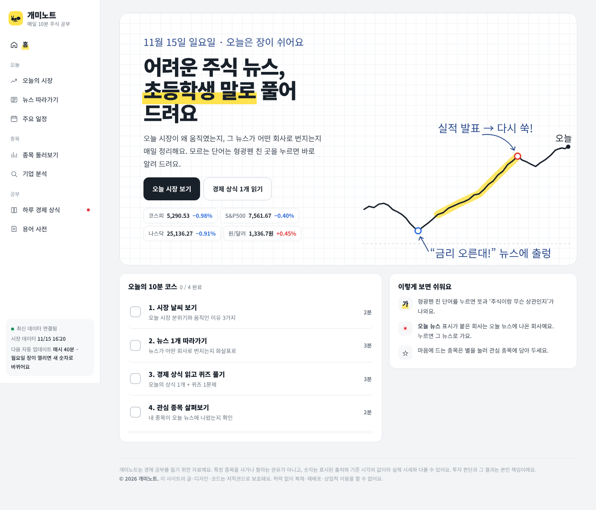 | 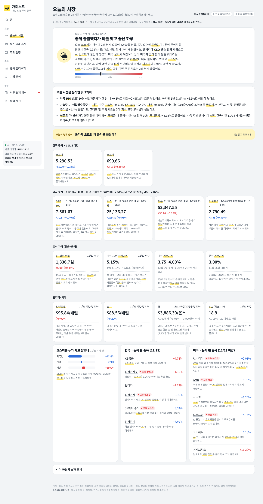 |
| 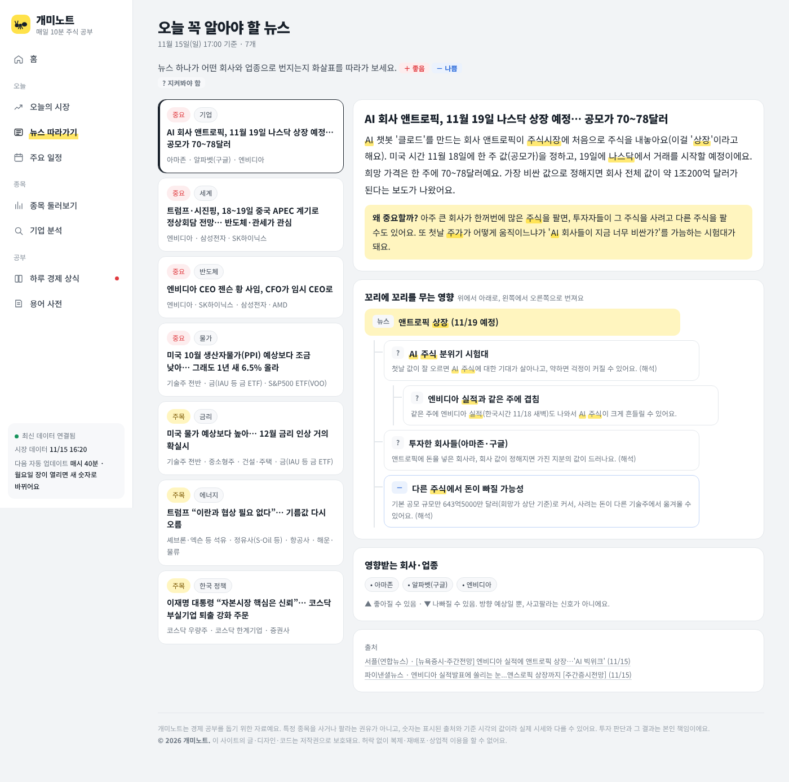 | 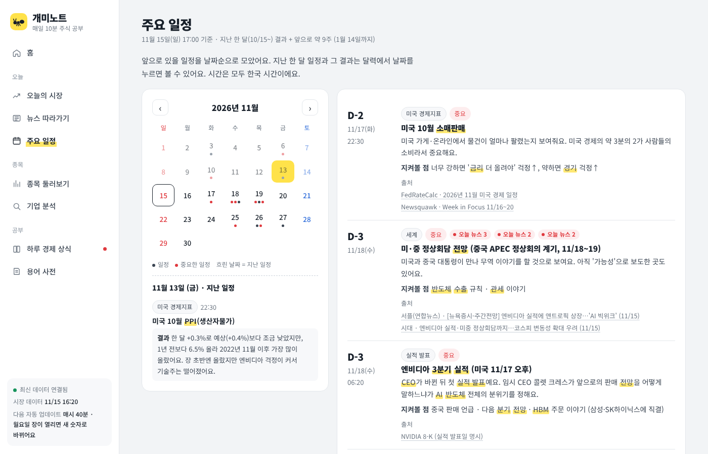 |
| 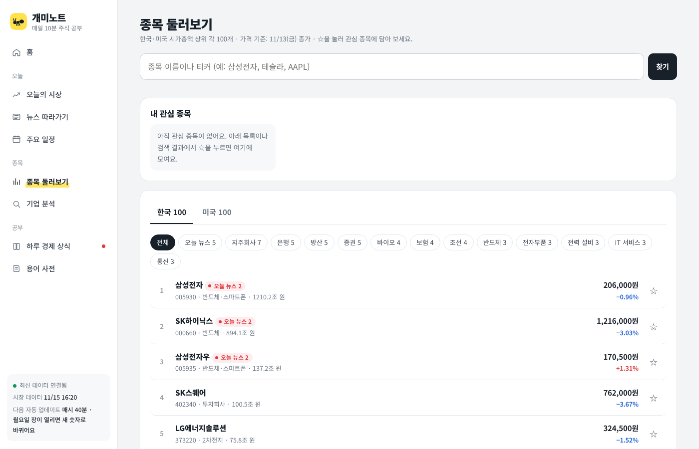 | 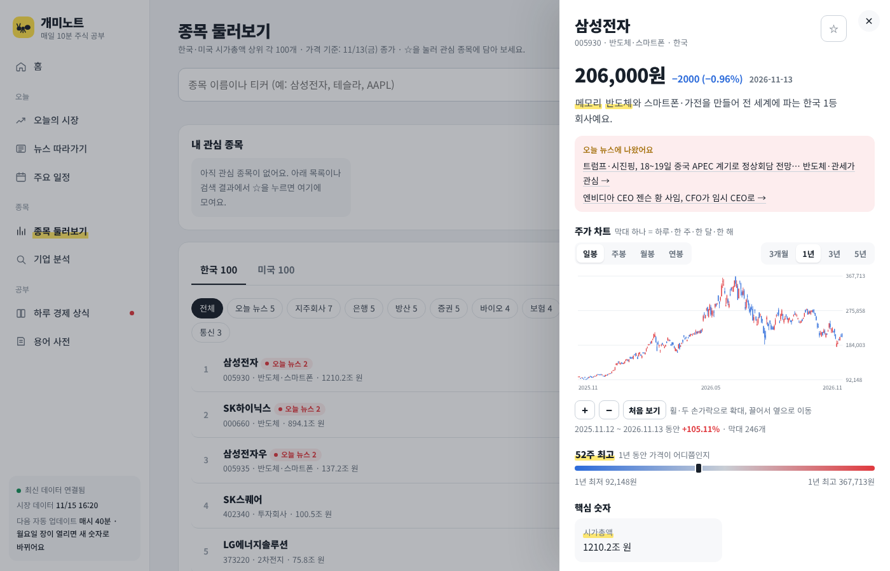 |
| 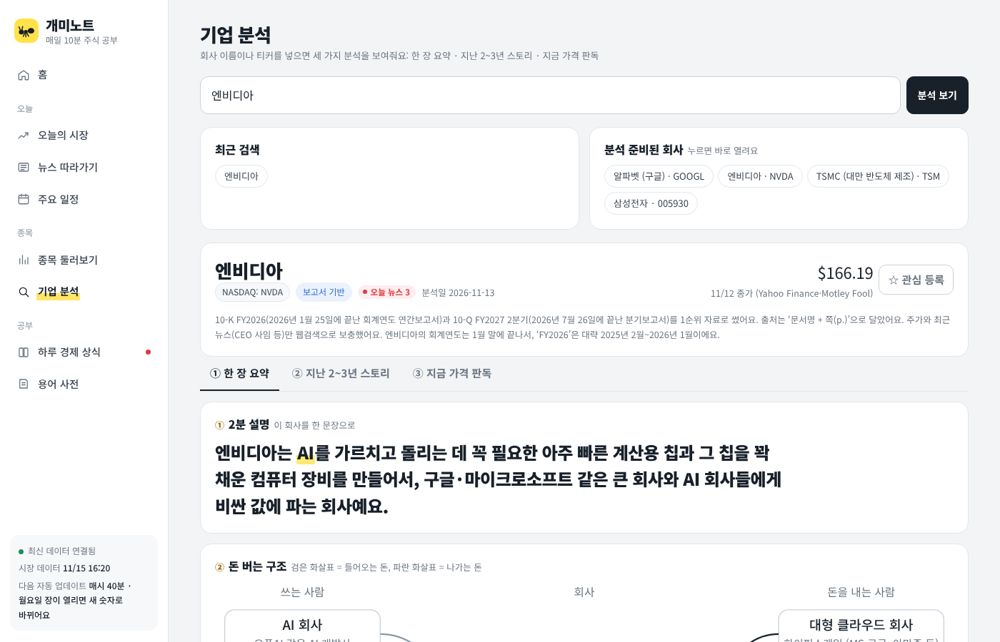 | 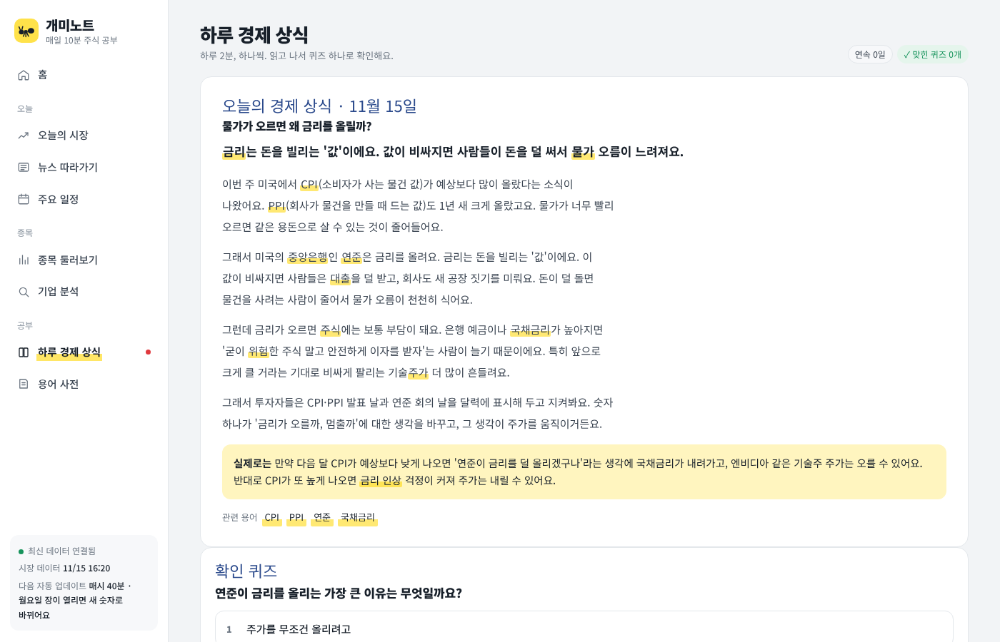 |
| 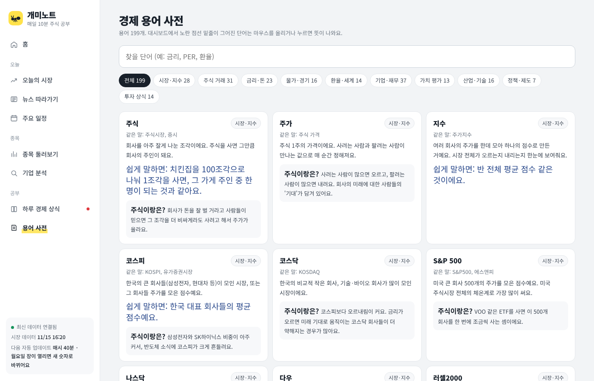 | 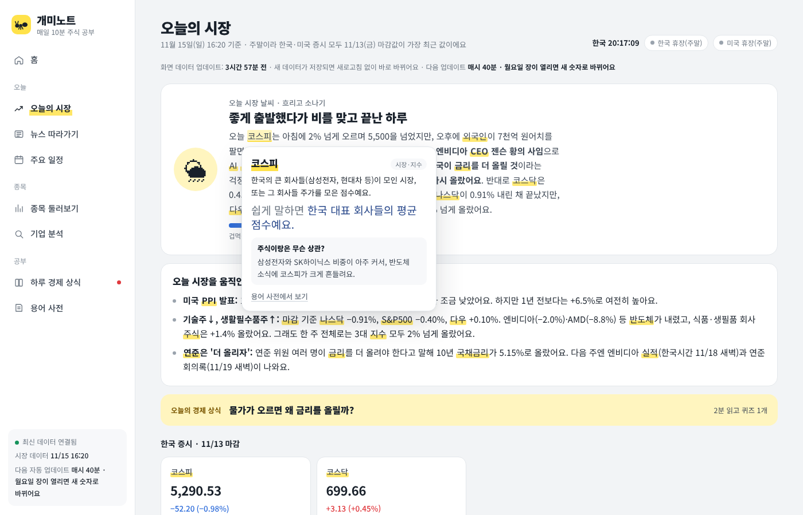 |
| 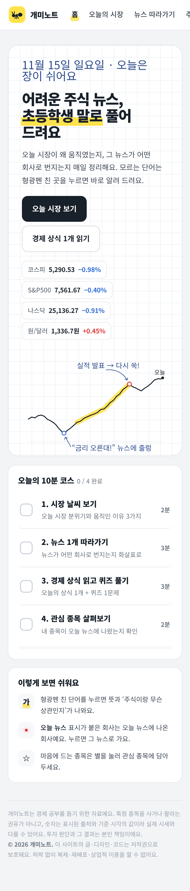 | 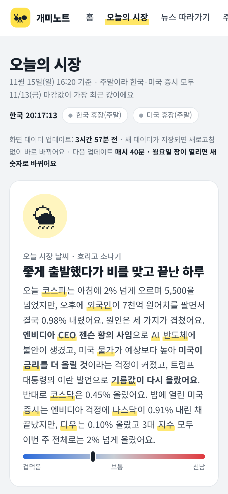 |
